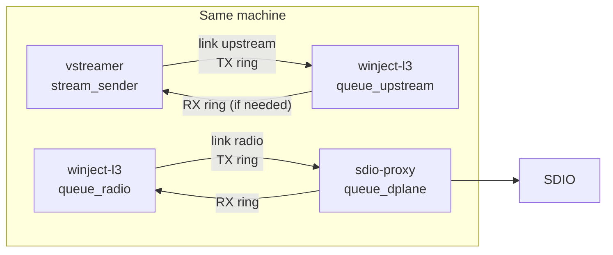

# Internal TX/RX dual queue (IPC)

Avoid expensive loopback networking between colocated components by using **dual queues** (two unidirectional SPSC rings per link) while keeping **datagram semantics**.

## Problem

On **ESP32-P4**, `winject-l3` and `winject_proxy` both use lwIP; the radio path today is **UDP inject/forward on port 9000** (same as Ethernet radios). That implies memcpy plus UDP/IP/stack loopback even when producer and consumer are on the same chip.

The **vstreamer → manager** hop on the host is the same pattern: RTP/TS over `127.0.0.1` into `UDP_*_FORWARDING`.

## Topology



| Link | Producer → consumer | Replaces | Typical payload |
|------|---------------------|----------|-----------------|
| **upstream** | `stream_sender` → `queue_upstream` | `udpsink` / `UDP_SERVER_FORWARDING` | RTP or MPEG-TS (≤ ~64 KiB cap you choose) |
| **radio** | `queue_radio` → `queue_dplane` | `WifiUdp::send` → proxy `dplane_task` `recvfrom` | D-plane UDP payload 1–1500 B (registration 1–23, MPDU ≤ 1472) |

Reverse rings matter for **radio RX** (proxy → manager) and lightly for upstream (stats/control later); video TX is mostly one-way on upstream.

## One primitive: `winject_dual_queue`

Shared **C ABI** (usable from C proxy, C++ manager, vstreamer):

```c
// winject_dual_queue.h — one link, two SPSC rings (A→B and B→A).
typedef struct winject_dq_link winject_dq_link_t;

typedef struct {
    const char *name;           // "upstream", "radio"
    uint16_t max_payload;       // 1500 radio; 8192+ upstream
    uint16_t depth;             // slot count per direction
    uint8_t  wake_fd;           // eventfd (Linux) or -1 (in-process notify)
} winject_dq_config_t;

// Side A opens creator; side B attaches (shm name / static symbol on P4).
winject_dq_link_t *winject_dq_open_a(const winject_dq_config_t *cfg);
winject_dq_link_t *winject_dq_open_b(const winject_dq_config_t *cfg);

// Non-blocking producer (matches wait_free_queue / try_push semantics).
int winject_dq_try_push_tx(winject_dq_link_t *dq, const void *data, uint16_t len);
int winject_dq_try_pop_rx(winject_dq_link_t *dq, void *buf, uint16_t cap, uint16_t *out_len);

// From B's POV, use push on its TX (= A's RX) — or symmetric API:
// winject_dq_try_push(winject_dq_link_t *, enum winject_dq_dir, ...);
```

**In-process (P4 single firmware):** one `struct` with two rings in `.bss` / static; no fds.

**Split processes (Linux host):** one `memfd` or `shm_open` region holding header + both rings + slot pool; pass fd via `SCM_RIGHTS` on a Unix socket once, or fixed path under `/dev/shm/winject-<name>`.

## Memory layout (single copy)

Avoid “ring of pointers into another heap”. Use a **slot pool** in the same mapping:

```
[ header: magic, version, depth, max_payload, stats ]
[ ring_ab: head/tail + slot indices ]
[ ring_ba: head/tail + slot indices ]
[ slots[depth*2]: uint16_t len + payload[max_payload] ]
```

- **SPSC** per direction: producer only advances `tail`, consumer only advances `head` (cache-line padded).
- **Push:** claim free slot index from a local free stack (producer-only) or use “ring owns slot until pop” with fixed `depth` slots per direction.
- **Pop:** copy out once into `bfc::sized_buffer` / stack buf (manager) or zero-copy handoff if you add **loan API** later (`pop_iov` + `release(slot)`).

This mirrors the air side: bounded depth, **try_push** on hot paths, drops counted explicitly.

## Wake / reactor integration

| Runtime | Mechanism |
|---------|-----------|
| Linux `winject-l3` | `eventfd` per direction; register with `IOReactor` / `epoll`; drain all frames in the callback (like UDP `recv` loop). |
| ESP-IDF manager | `xTaskNotify` or a byte on the existing BFC wake path; **replace** `port/pipe.c` loopback UDP for self-wake where possible. |
| `winject_proxy` | `dplane_task` blocks on `ulTaskNotifyTake` / queue handle instead of `recvfrom`; SDIO TX task unchanged. |
| vstreamer | After successful `try_push`, `eventfd_write` (or skip wake if manager polls upstream in same tick). |

Rule: **one wake per burst**, not per datagram; consumer drains until empty.

## Component wiring

### 1. `vstreamer:stream_sender` → `winject-l3:queue_upstream`

- New sink backend: `dq_sink` instead of `udpsink`.
- Manager: new upstream mode e.g. `IPC_DUAL_QUEUE` (or keep config shape: `bind_address = dq:upstream`).
- `UdpEndpoint` already funnels app ingress into `on_app` / `push_tx`; swap the socket `recv` path for `winject_dq_try_pop_rx` on the upstream link’s **A→B** ring.
- **Backpressure:** byte cap + drop-oldest + counters (`tx_drop_pkt` / `tx_drop_byt`), not unbounded `tx_shards_`.

### 2. `winject-l3:queue_radio` ↔ `winject-proxy:queue_dplane`

- Introduce `RadioTransport` interface; **`WifiUdp`** is one implementation; **`WifiDualQueue`** is another.
- TX: `TxMux` / `WifiUdp::send` → `winject_dq_try_push` on **manager→proxy** ring (inject + registration bytes unchanged).
- RX: proxy `on_link_message` (SDIO → host today → `sendto`) → push on **proxy→manager** ring; manager reactor pops and feeds existing `RxDemux` / `on_radio_rx` as today.
- **Registration (1–23 B):** still learned from datagrams on the RX ring; optional `flags` bit `REGISTRATION` in frame header to skip `dplane_classify` on length alone.
- Proxy config: `winject_proxy_start()` flag `use_local_dq = true` skips `bind_udp(9000)` for the manager-facing side (still bind 9000 for LAN if you want remote manager).

On **P4 all-in-one**, both ends can be **symbols in one image** (`extern winject_dq_link_t g_radio_link`); no memfd.

## Frame header (optional but useful)

Keep payloads **byte-identical** to today’s UDP bodies for easy A/B:

```c
struct winject_dq_hdr {
    uint16_t len;      // payload only
    uint16_t flags;    // bit0: registration; bit1: fec; rest reserved
    uint32_t seq;      // gap detection → maps to existing air_seq / stats
} __attribute__((packed));
```

If `flags == 0`, classify with existing `dplane_classify(len)` on the radio link.

## Config sketch

```ini
# winject-l3
upstream-0.mode = IPC_DUAL_QUEUE
upstream-0.dq_name = upstream

winject.radio_transport = dq
winject.radio_dq_name = radio
```

```c
// sdio-proxy / combined P4 app
winject_proxy_config_t cfg = WINJECT_PROXY_CONFIG_DEFAULT();
cfg.dplane_backend = WINJECT_PROXY_DPLANE_DQ;
cfg.dq_link = &g_radio_link;  // or name "radio"
```

Fallback: `radio_transport = udp` + `127.0.0.1:9000` for benches and Ethernet radios.

## Rollout order

1. **Radio link on P4** (biggest win): in-process dual queue between `winject_l3` and `winject_proxy`; keep UDP for off-device managers.
2. **Upstream link on host**: memfd DQ between vstreamer and manager; keep `UDP_SERVER_FORWARDING` in configs.
3. Tests: loopback-style GTest that pushes registration + MPDU through DQ into `RxDemux`; parity test against existing `WifiUdpTest` UDP fixtures.
4. Later: loaned buffers from slot pool into `bfc::sized_buffer` to remove the second copy on RX.

## What this does not replace

- **SDIO** (`sdio_link_host_send`) stays as-is; only **lwIP loopback between manager and proxy** is removed.
- **Remote** manager → P4 over LAN still uses real UDP 22/9000.
- **M-plane** can stay UDP for now (low rate); same DQ pattern applies if you colocate that too.

## Open choices

| Topic | Suggestion |
|-------|------------|
| Depth (radio) | 32–64 slots × 1500 B (~48–96 KiB per direction) — comparable to `tx_queue_sz` + SDIO buffering |
| Depth (upstream) | Byte budget (e.g. 256 KiB) rather than fixed packet count |
| Multi-writer upstream | One writer (vstreamer); if GStreamer + tool both send, keep UDP or add an MPSC variant later |
| Security | DQ is local-only; no auth (same as loopback UDP today) |

## Repo placement

Natural home: **winject-l3** (`src/manager/ipc/` + `idf/winject_l3`) with a thin header vendored into **sdio-proxy** and **vstreamer**.
